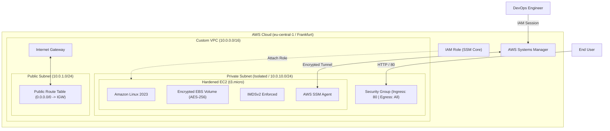

# Production-Grade AWS VPC & Hardened EC2 Infrastructure

An enterprise-ready, hardened AWS infrastructure provisioned with Terraform (v1.9.0) in Frankfurt (eu-central-1). Designed according to the AWS Well-Architected Framework, prioritizing Zero Trust network isolation, static security analysis (tfsec/TFLint), automated CI/CD quality gates, and strict cost optimization (FinOps).

---

## Architecture Overview

---

## Security & Hardening Features

* Zero Open Management Ports: Traditional SSH (port 22) is completely eliminated. Administrative access is managed through AWS Systems Manager (SSM Session Manager) via encrypted IAM-authenticated sessions.
* Instance Metadata Service v2 (IMDSv2): Http-tokens are set to required with a single hop limit to mitigate SSRF (Server-Side Request Forgery) attacks.
* At-Rest Disk Encryption: Root EBS block devices are encrypted using standard AWS managed keys (AES-256).
* Strict Ingress Controls: Security group ingress is restricted strictly to HTTP (port 80) for web traffic.
* Static Analysis & Linting: Codebase passes 100% of TFLint rules and tfsec security checks with no unmitigated critical or high vulnerabilities.

---

## CI/CD Pipeline (GitHub Actions)

Every pull request and push to the main branch triggers automated quality gates:

1. Terraform Format: Verifies adherence to canonical formatting style (terraform fmt -check).
2. Code Validation: Validates internal consistency and configuration syntax (terraform validate).
3. Security Scanning: Runs Aqua Security tfsec action to detect IaC misconfigurations before deployment.

---

## Requirements

* Terraform >= 1.9.0
* AWS CLI configured with appropriate IAM credentials
* AWS Region: eu-central-1 (Frankfurt)

---

## Inputs

| Name | Description | Type | Default |
| --- | --- | --- | --- |
| aws_region | Target AWS deployment region | string | eu-central-1 |
| vpc_cidr | Primary CIDR block for the custom VPC | string | 10.0.0.0/16 |
| public_subnet_cidr | CIDR block for public tier | string | 10.0.1.0/24 |
| private_subnet_cidr | CIDR block for isolated application tier | string | 10.0.10.0/24 |
| instance_type | EC2 compute instance size | string | t3.micro |

---

## Outputs

| Name | Description |
| --- | --- |
| vpc_id | Identifier of the provisioned custom VPC |
| public_subnet_id | Identifier of the public subnet |
| private_subnet_id | Identifier of the isolated private subnet |
| app_server_instance_id | EC2 instance ID for SSM connectivity |

---

## Deployment & Lifecycle

Initialize the working directory:

terraform init

Inspect the execution plan:

terraform plan

Deploy the infrastructure:

terraform apply -auto-approve

Connect securely via SSM:

aws ssm start-session --target $(terraform output -raw app_server_instance_id)

Destroy all resources (FinOps zero-cost teardown):

terraform destroy -auto-approve

